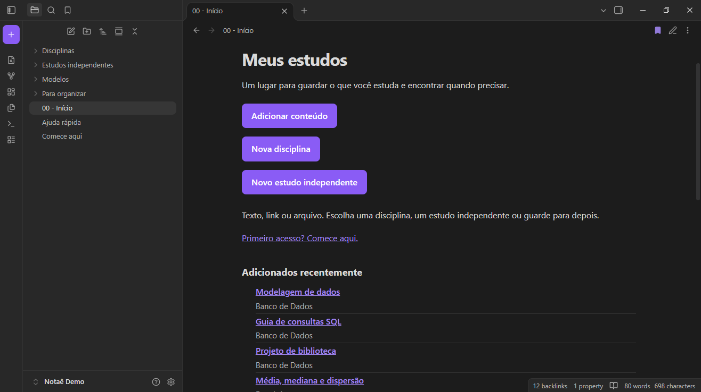
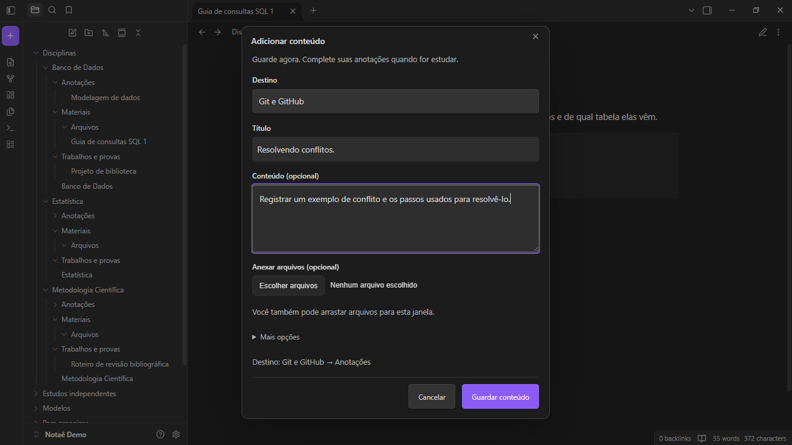
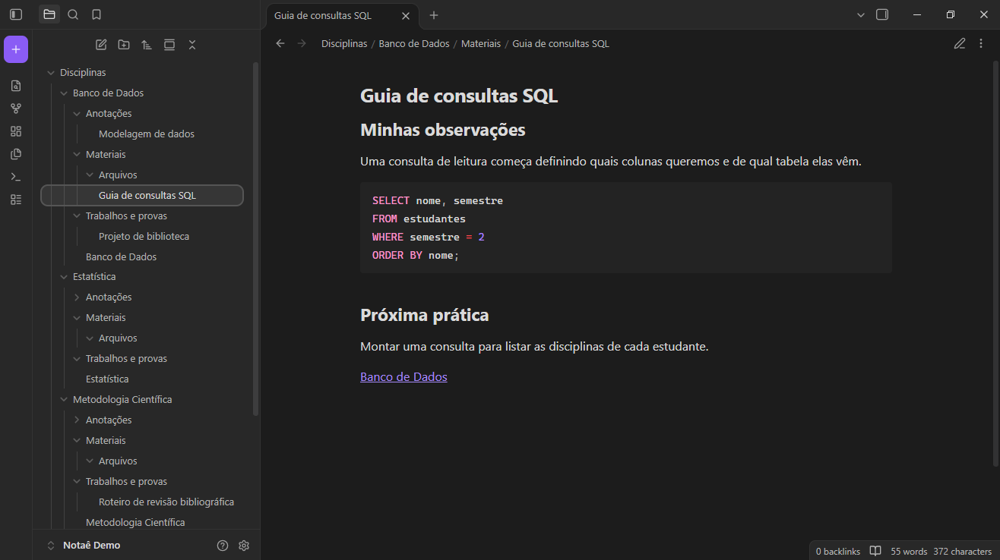
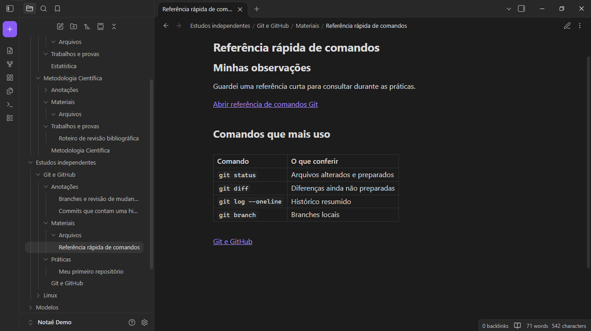

# Notaê

**Clareza para organizar seus estudos.**

Um modelo de vault para Obsidian, em português brasileiro, com um complemento local para criar disciplinas, organizar estudos independentes e guardar textos, links e arquivos.

Feito para quem quer estudar sem começar montando um sistema de organização. Você informa o assunto; o Notaê cria a estrutura.



*Suas ações principais e seus conteúdos recentes em um só lugar. Capturas feitas com dados fictícios do vault de demonstração.*

## O que você pode fazer

- Criar disciplinas com anotações, materiais, trabalhos e provas.
- Criar estudos independentes, como Linux ou Git, com anotações, práticas e materiais.
- Adicionar texto, links e vários arquivos em um formulário.
- Guardar algo em **Para organizar** e escolher o destino depois.
- Encontrar seus assuntos e os seis conteúdos mais recentes no início.
- Continuar lendo e editando arquivos Markdown mesmo sem o complemento.

O modelo começa vazio. Não exige um curso específico, nome de vault, conta online ou chave de API. Não há IA, calendário, lembretes ou sincronização incluídos.

## Veja como funciona

### Adicionar conteúdo



*Escolha um destino, escreva um título e guarde texto, links ou arquivos pelo mesmo formulário.*

### Materiais de uma disciplina



*Reúna explicações, exemplos de código e próximos passos dentro de cada matéria.*

### Estudos independentes



*Organize assuntos que você estuda por conta própria, com espaço para anotações, práticas e materiais.*

## Comece a usar

1. Instale o [Obsidian](https://obsidian.md/download).
2. Baixe este repositório por **Code → Download ZIP** e extraia o arquivo.
3. Copie a pasta **vault** para o local em que você guarda seus estudos. Você pode renomeá-la para **Notaê** ou outro nome.
4. No Obsidian, escolha **Abrir pasta como vault** e selecione essa pasta, que contém `00 - Início.md`, `Modelos` e `.obsidian`.
5. Leia o aviso de confiança do Obsidian e habilite os plugins da comunidade se estiver de acordo. Em **Configurações → Plugins da comunidade**, ative **Notaê**. O complemento já vem incluído; não está publicado no catálogo da comunidade.
6. Abra **Comece aqui** ou **00 - Início** e crie seu primeiro assunto.

Se você recebeu o pacote `notae-v0.1.0.zip`, extraia e abra diretamente a pasta **Notaê** dentro dele. Não abra o ZIP como vault.

Os botões ficam no topo do início: **Adicionar conteúdo**, **Nova disciplina** e **Novo estudo independente**. Use a visualização de leitura se estiver vendo a sintaxe dos links. Se os botões não estiverem estilizados, ative **Configurações → Aparência → Trechos CSS → faculdade**.

### Exemplo

Crie o estudo **Linux**. Na página dele, clique em **Adicionar conteúdo** e dê o título **Permissões de arquivos**. Para registrar um exercício, escolha **Mais opções → Organizar como → Exercício ou prática**.

O resultado será uma nota em `Estudos independentes/Linux/Práticas/`, com link de volta para Linux. O nome Linux é apenas um exemplo: qualquer tema válido pode ser criado.

## Estrutura

```text
vault/
├── 00 - Início.md
├── Comece aqui.md
├── Ajuda rápida.md
├── Disciplinas/
├── Estudos independentes/
├── Modelos/
├── Para organizar/
└── .obsidian/
    ├── plugins/notae/
    └── snippets/
```

As pastas vazias recebem arquivos `.gitkeep` para permanecerem no GitHub; eles não são conteúdo de estudo. As subpastas de cada assunto são criadas quando você o cadastra.

## Compatibilidade e limites

- O código não usa APIs exclusivas de desktop e o manifesto permite dispositivos móveis. **O Android ainda precisa de teste manual desta edição pública.**
- A suíte automatizada executa os fluxos em um vault simulado, sem abrir o Obsidian nem alterar notas reais.
- O conteúdo continua em arquivos locais. Nenhuma sincronização é configurada automaticamente.
- O complemento não solicita credenciais nem realiza chamadas de rede. Links e anexos que você abrir podem usar outros aplicativos ou serviços.
- Nomes de assuntos e de suas páginas principais precisam corresponder. Para renomear um assunto manualmente, ajuste pasta, página e seus atalhos.
- Exportar um vault já usado pode incluir suas notas. A geração do pacote usa uma lista explícita de arquivos do modelo e recusa itens extras, para não empacotar conteúdos de estudo acidentalmente.

## Desenvolvimento

Para gerar uma demonstração preenchida com exemplos fictícios e um guia de capturas, execute `npm run demo`. O arquivo `dist/notae-demo-screenshots.zip` contém um vault separado, **Notaê Demo**, com três disciplinas e dois estudos independentes. O modelo vazio e suas notas pessoais não são alterados.

É preciso Node.js 22 ou superior para executar as verificações e gerar o pacote. Não é necessário Node.js para usar o vault no Obsidian.

```sh
npm test
npm run check
npm run package
```

Não há dependências npm externas. O código do complemento é o próprio `vault/.obsidian/plugins/notae/main.js`; não precisa de compilação. O empacotador gera `dist/notae-v0.1.0.zip` incluindo `.obsidian`, o modelo, a licença e um guia de instalação.

O `.gitignore` evita adicionar novas notas de estudo aos caminhos mais comuns. Ele não substitui a revisão do que será enviado ao GitHub. Prefira usar uma cópia do vault para estudar e manter o repositório para desenvolvimento.

Veja [como contribuir](CONTRIBUTING.md), [as verificações da versão](docs/VERIFICACAO.md) e [os próximos passos para publicar](docs/PUBLICACAO.md).

## Autoria e licença

Criado por [LukCandeia](https://github.com/LukCandeia), com assistência de IA no desenvolvimento. O projeto não é afiliado ao Obsidian, que é um aplicativo independente e não é redistribuído aqui.

Código, estilos e modelos próprios sob a [licença MIT](LICENSE). Ela permite uso, modificação e redistribuição, inclusive comercial, preservando os avisos de copyright e licença. Inclui ausência de garantia e limitação de responsabilidade; não representa garantia de imunidade legal. O projeto é disponibilizado sem compromisso de suporte ou manutenção contínua.
